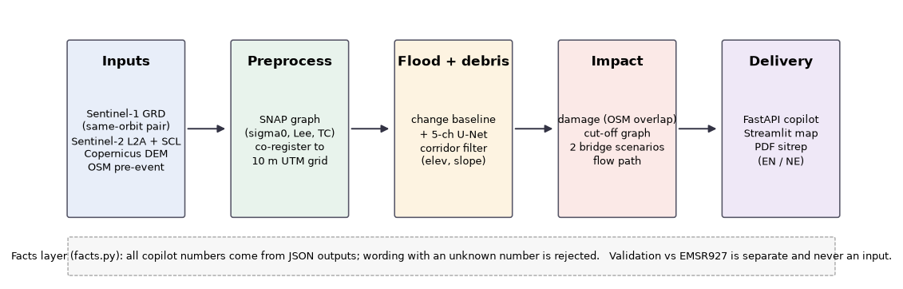

# Satellite flood damage assessment: Bhote Koshi / Trishuli, 26 August 2026

## Abstract

We present an end-to-end, reproducible system that turns Sentinel-1 and Sentinel-2 imagery, a DEM and pre-event OpenStreetMap into a flood damage and access assessment for any area and date. A same-orbit radar change baseline and a change-aware U-Net map flood water; a separate mask captures debris; overlaying roads and buildings yields exposure, and a pre-event road graph identifies settlements newly cut off under two bridge scenarios. A copilot answers in English and Nepali using only numbers from the outputs. For the 26 August 2026 Bhote Koshi/Trishuli flood, the flood mask reaches an IoU of PENDING against Copernicus EMS EMSR927 (F1 PENDING; tolerant F1 PENDING), and PENDING settlements are flagged as cut off. These are lower-bound, exposure-based estimates; EMSR is an analyst product, not ground truth.

## Architecture

Every stage is a command-line module that reads and writes files; `python -m src.pipeline --aoi <config> --date <date>`
chains them for any area and date. UTM zone, windows and thresholds come from the AOI config, nothing is hard-coded.

## Methods

**Pairing.** Sentinel-1 GRD scenes are searched through the Copernicus Data Space catalogue. The pre-event scene must share
the post-event scene's relative orbit and cover at least 90% of the AOI, so layover and shadow cancel in the difference.
Sentinel-2 L2A scenes are chosen by cloud cover and masked with the scene classification layer.

**Flood and debris.** After SNAP preprocessing (orbit file, noise removal, sigma0, Lee Sigma 3x3, terrain correction at
10 m with the Copernicus DEM), the baseline flags pixels that became dark and were not water before, restricted to
low slopes and low height above the channel to suppress wet snow and shadow. A 5-channel U-Net (post VV/VH, pre VV/VH, VV
change) trained on Kuro Siwo, validated on held-out events, is used only where it beats the baseline. Debris is a separate
mask from radar backscatter increase and optical vegetation loss.

**Damage and access.** Buildings, roads and bridges from a pre-event OSM snapshot are overlaid on the hazard footprint.
A road graph built from the same snapshot finds settlements that could reach a hospital or district centre before the
event and cannot after it. Results are given for bridges intact and for exposed bridges failing. A priority-flood D8 path
traces where water goes downstream of the source.

**Copilot.** A tool layer (`facts.py`) returns numbers from the JSON outputs. Any generated sentence containing a number
that is not in those files is rejected and replaced by an English or Nepali template.

**Validation.** EMSR927 is used only for evaluation, in a module nothing else imports. Flood extent is scored inside the EMSR
areas of interest, strictly and with a 1 pixel tolerance (EMSR is drawn on imagery of about 1 m, this system works at 10 m).

## Results

*Event outputs.* New flood water PENDING; debris
PENDING; radar could not observe
PENDING of the area. Buildings in the hazard zone:
PENDING (high overlap PENDING); road in hazard
PENDING; bridges exposed PENDING of PENDING.
Settlements cut off with bridges intact: PENDING; additionally cut off if exposed bridges fail:
PENDING.

*Model on held-out Kuro Siwo test events (flood class, pixels).*

| Method | IoU | F1 | Precision | Recall |
|---|---|---|---|---|
| Threshold baseline | 55.1% | 71.1% | 89.6% | 58.9% |
| Change-aware U-Net | 55.9% | 71.7% | 59.3% | 90.8% |

*Against EMSR927 (flood + debris, inside EMSR areas only).* Strict IoU PENDING, F1 PENDING,
precision PENDING, recall PENDING. With 1 pixel tolerance: F1 PENDING
(precision PENDING, recall PENDING). Flood mask alone, without debris: IoU
PENDING.

*Buildings (EMSR-graded vs our "in hazard").* EMSR-affected buildings matched to an OSM footprint:
PENDING (this is a measure of OSM completeness). Recall on matched affected buildings
PENDING; precision PENDING, a lower bound because
exposure is not damage.

*Roads, bridges, cut-off.* Damaged road length ours PENDING km vs EMSR PENDING km
(precision PENDING, recall PENDING). Bridges: EMSR damaged PENDING,
recall PENDING. Cut-off lists, ours vs EMSR-derived: Jaccard PENDING
(only ours: none; only reference: none).

*Where and why we disagree.* Image timing: PENDING days between the Sentinel-1
post scene and the EMSR source image. Radar unobservable share PENDING; Sentinel-2 clear on both dates
PENDING. Resolution and timing differences are the first suspects for any boundary disagreement;
see the confusion matrix and side-by-side maps in `reports/fig_val_*.png` and notebook 06.

## Limitations

- **Exposure is not damage.** "Building in hazard zone" means the footprint overlaps the flood or debris mask. It does
- **Cut-off means "no road route", not "no access".** Footpaths, trails, helicopters and fords are not modelled. A
- **Two bridge scenarios, not a prediction.** Whether an exposed bridge actually failed is unknown from satellite data.
- **Sentinel-1 geometry.** Layover and shadow hide steep Himalayan slopes. Same-relative-orbit pairs make them cancel
- **Wet snow and ice** lower radar backscatter like water. The flood-corridor filter (relative elevation and slope)
- **Clouds.** Sentinel-2 is unusable under monsoon cloud. Where optical data are missing, only radar is used and the
- **Resolution.** 10 m pixels against building footprints of about 8 to 10 m: one pixel of misregistration decides
- **OSM completeness.** The pre-event snapshot is the only road and building source. Mapped coverage is uneven, and the
- **No Himalayan evidence in the training data.** The Kuro Siwo events used contain no Himalayan flash floods or
- **EMSR927 is an analyst product, not ground truth.** It is drawn from very-high-resolution imagery by people,
- **Timing mismatch.** EMSR and Sentinel-1 were acquired at different times. Floods recede and debris moves between
- **Nepali text has not been reviewed by a native speaker.** Treat it as a draft.

The full list (25 items) is in `reports/limitations.md`.
No casualty or population estimates are made. All outputs are automated estimates that need human review.

## Attributions and citations

Contains modified Copernicus Sentinel data 2026. Produced using Copernicus WorldDEM-30 © DLR e.V. 2010-2014 and © Airbus Defence and Space GmbH 2014-2018 provided under COPERNICUS by the European Union and ESA; all rights reserved. © OpenStreetMap contributors (ODbL). Training data: Kuro Siwo (Bountos et al., NeurIPS 2024, MIT License); Sen1Floods11 (Bonafilia et al., CVPR Workshops 2020, CC BY 4.0). Evaluation reference: European Union, Copernicus Emergency Management Service data (EMSR927), used for validation only, not as model input.

Bountos, N. I. et al., *Kuro Siwo: 33 billion m² under the water. A global multi-temporal satellite dataset for rapid flood
mapping*, NeurIPS Datasets and Benchmarks 2024. Bonafilia, D. et al., *Sen1Floods11*, CVPR Workshops 2020. Iakubovskii, P.,
*Segmentation Models PyTorch*. Pre-event OSM through the ohsome API (HeiGIT). Weights and code: MIT unless stated.

## Reproducibility

Code: https://github.com/ShivanyaT/trishuli-flood-response.git. One command: `docker compose up` (synthetic demo, API on :8000, dashboard on :8501). Real event:
`python -m src.pipeline --aoi config/aoi_trishuli.yaml --date 2026-08-26` with CDSE credentials in `.env`, then
`python -m src.validate run ...` for the EMSR927 comparison and `python -m src.final_report` for this document. All numbers
here are read from `data/outputs/*.json`, `reports/eval_metrics.json` and `reports/validation.json`; `PENDING` means that step has
not been run. Tests: `pytest` (synthetic town with known answers).
